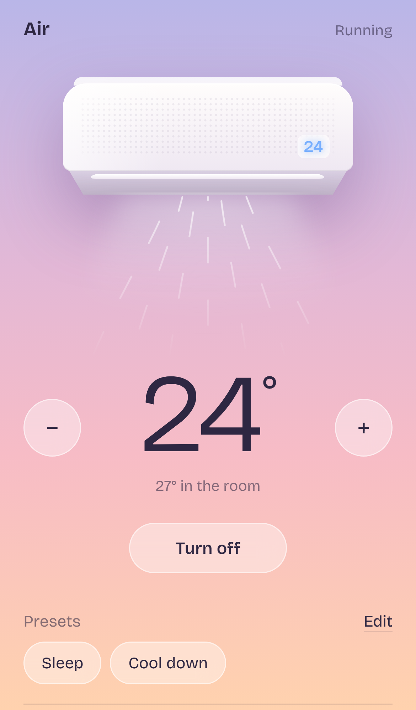
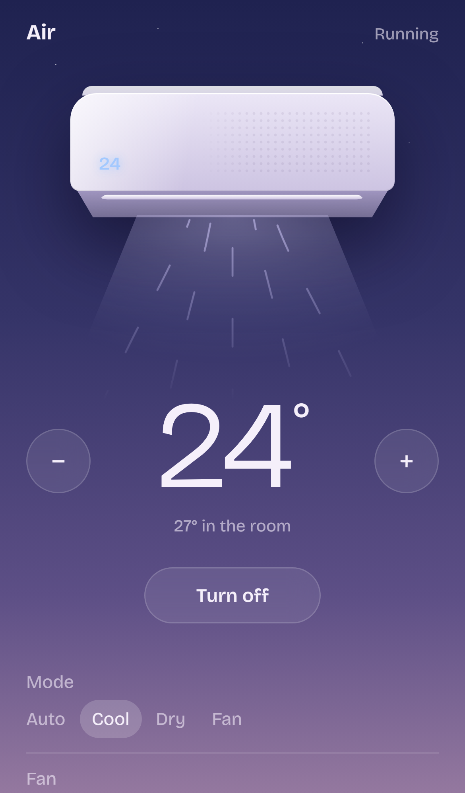
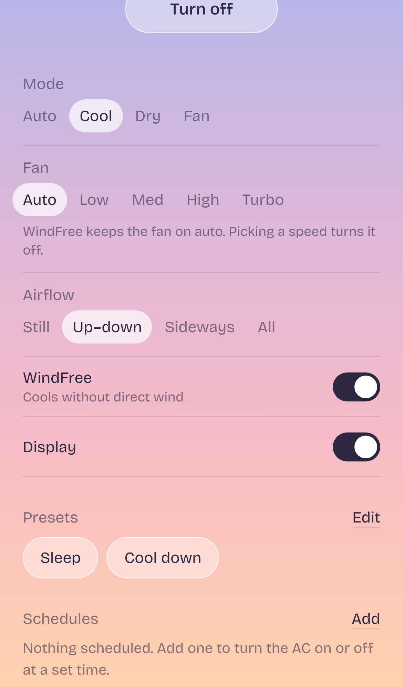
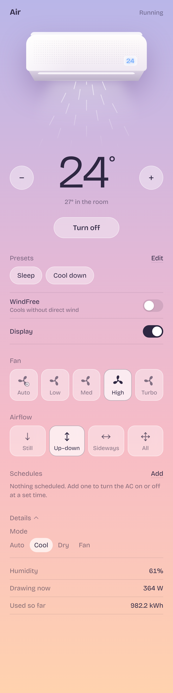
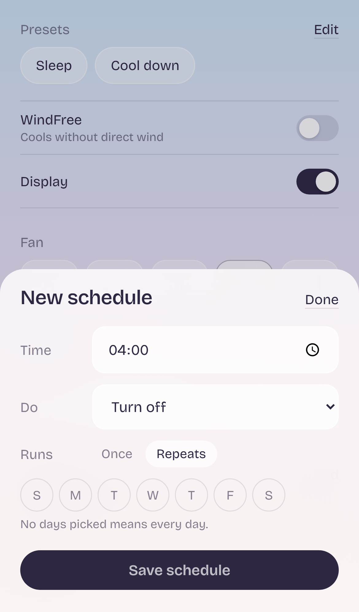

# Air

A small, calm remote for a Samsung WindFree air conditioner. It runs on Vercel, talks to the
SmartThings cloud, works from the iPhone home screen and from Siri, and keeps its SmartThings
access alive on its own.

<p align="center">
  
  
  
</p>

The background follows the time of day (dawn, day, sunset, night). The AC is animated from its
real state: the louver follows the airflow setting, the streams speed up with the fan, and WindFree
turns the air into a slow mist.

## What it does

- Power, temperature, mode (auto, cool, dry, fan), fan speed, airflow direction, WindFree, display.
- Editable presets ("Sleep", "Cool down", or save whatever the AC is doing now).
- Schedules that run in the cloud (Upstash QStash), so they don't depend on your phone.
- Siri: one shortcut per command, and Siri reads the answer back. See [docs/siri.md](docs/siri.md).
- Humidity and power use, tucked away under Details.

<p align="center">
  
  
</p>

## How it's built

Two independent parts in one repo:

| Part | What it is |
|---|---|
| **app** (repo root) | Next.js on Vercel. UI + API. Stores the SmartThings token in Upstash Redis. |
| **[refresher/](refresher/)** | A Playwright robot on GitHub Actions. Every 12 hours it creates a new SmartThings personal access token and hands it to the app. |

Why the robot: since November 2026 SmartThings OAuth apps require a paid developer plan, and personal
access tokens expire after 24 hours. The robot reuses a signed-in Samsung session (you sign in once,
captcha included) to mint a new token before the old one runs out. Your password is never stored;
the session is encrypted with a key only the robot has. The OAuth flow is still in the code
(`/api/auth/*`) if you have the paid plan.

## Setup

You need a Vercel account, a GitHub account and a Samsung account with the AC in SmartThings.

1. **Deploy the app.** Fork this repo, import it in Vercel, then add the integrations
   *Upstash for Redis* and *Upstash QStash* from the Vercel Marketplace (both free tiers).
2. **Set the app variables** in Vercel:

   | Variable | Value |
   |---|---|
   | `AC_API_KEY` | A long random string. It's your password for the app, Siri and the robot. |
   | `ST_DEVICE_ID` | Optional. Without it the first AC in the account is used. |
   | `AC_TIMEZONE` | Optional. Time zone for schedules, default `America/Sao_Paulo`. |

   Redis and QStash variables are added by the integrations. Redeploy after setting them.
3. **Open the app**, enter the access key, and paste a token from
   [account.smartthings.com/tokens](https://account.smartthings.com/tokens) (Devices permissions).
   You're controlling the AC now. The next steps make it permanent.
4. **Set up the robot.** See [refresher/README.md](refresher/README.md): sign in once with
   `npm run login`, then add three GitHub secrets. From then on a new token arrives every 12 hours.
5. **Add it to your home screen.** In Safari: Share → Add to Home Screen.
6. **Siri.** Follow [docs/siri.md](docs/siri.md).

## API

Every route needs the `x-ac-key` header (or the app's session cookie).

| Route | Does |
|---|---|
| `GET /api/ac` | Normalized status |
| `POST /api/ac` | Desired state: `{ power, temp, mode, fan, swing, windFree, optionalMode, display }`, all optional, sent as one command |
| `POST /api/ac/preset/:id` | Applies a preset (id or name) |
| `GET` / `PUT /api/presets` | Lists / replaces presets |
| `GET` / `POST /api/schedules`, `DELETE /api/schedules/:id` | Schedules |
| `GET /api/siri/...` | Siri-friendly commands with spoken text answers ([docs/siri.md](docs/siri.md)) |
| `POST /api/pat` | Receives a SmartThings token |
| `GET /api/debug` | Devices, capabilities and raw status, for when something doesn't work |

## Development

```bash
npm install
AC_MOCK=1 AC_API_KEY=preview npm run dev   # simulated AC, no SmartThings or Redis needed
```

Open http://localhost:3000 with the key `preview`. `?sky=night` (or `dawn`, `day`, `sunset`) forces
a sky. Screenshots: `node scripts/screenshots.mjs` while the dev server runs.

Device-specific mappings (capability names, the display workaround) live in `lib/capabilities.ts`.

## License

MIT
